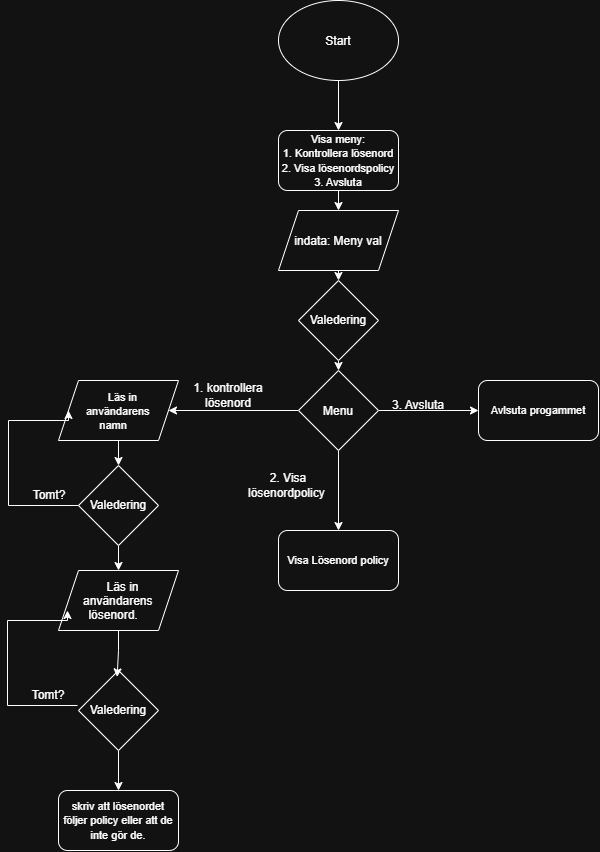

# Lab 3 – E. Lösenordskontroll
Gjort av: Liam Glamheden
## Del 1: Projektbeskrivning

1. Programmets namn och vad det gör
Lösenordskontroll – Programmet kontrollerar om ett lösenord följer lösenordspolicyn.

2. Användaren
Servicedesk som hjälper användare att byta lösenord. Programmet ska vara enkelt att använda och ge tydliga felmeddelanden.

3. Menyvalen

1. Kontrollera lösenord – Kontrollerar om lösenordet följer policyn.
2. Visa lösenordspolicy – Visar vilka krav som gäller för lösenord.
3. Avsluta – Avslutar programmet.

4. Indata
Användaren skriver in ett lösenord. Lösenordet ska vara minst 15 tecken långt och får inte finnas med bland vanliga lösenord.

## Del 2: Pseudokod och flödesschema

START
start loop
SÅ LÄNGE programmet körs:
    Skriv ut menyval 1: Kontrollera lösenord
    Skriv ut menyval 2: Visa lösenordspolicy
    Skriv ut menyval 3: Avsluta

    Läs in menyval

    OM menyval är 1:
        Läs in användarnamn
        Läs in lösenord

        OM lösenordet är kortare än 15 tecken:
            Visa felmeddelande
        ANNARS OM lösenordet är vanligt:
            Visa felmeddelande
        ANNARS OM lösenordet innehåller användarnamnet:
            Visa felmeddelande
        ANNARS:
            Visa att lösenordet är godkänt

    ANNARS OM menyval är 2:
        Visa lösenordspolicyn

    ANNARS OM menyval är 3:
        Avsluta programmet

    ANNARS:
        Visa felmeddelande
avslutad loop
SLUT

.

## Del 4: Användartest
## Del 5: Förbättringar och reflektion